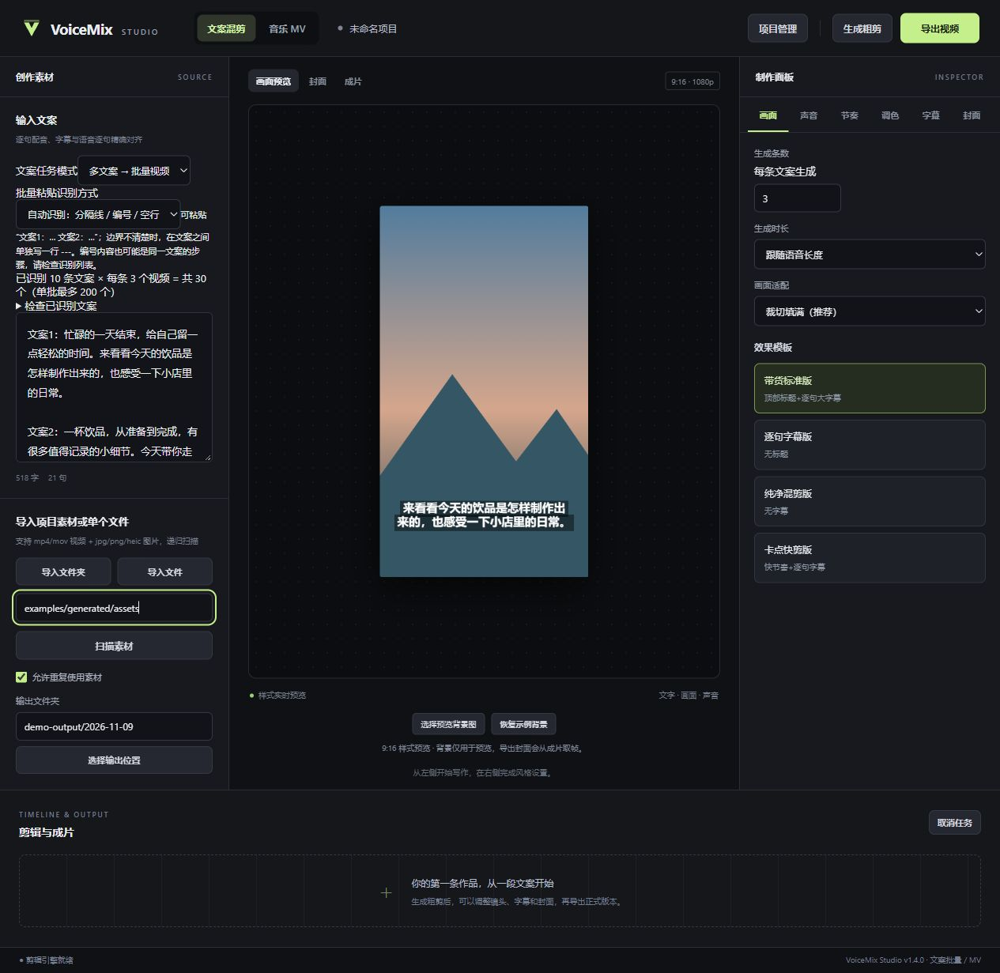

# VoiceMix Studio｜视频剪辑插件 · 文案驱动 · 自动批量混剪

**输入文案，生成语音；选定大批量素材库，自动随机混剪出多个视频版本。**

VoiceMix 是面向门店商户、电商卖家、广告创意制作和代运营团队的 **视频剪辑与自动批量混剪工具**。它以文案为起点，自动生成配音和跟随字幕，以语音时长组织视频时间轴，再从你选定的视频、图片素材库中随机选材、编排镜头，批量制作可预览、可修改的视频样板。

关键词：**视频剪辑 / 自动批量混剪 / 文案驱动 / 语音配音 / 素材库复用 / 随机混剪 / 广告视频制作 / Batch Video Editing**。

交付形态：当前提供可独立运行的 Windows / macOS 桌面应用，作为日常剪辑流程中的批量制作工具使用；“视频剪辑插件”是工作流定位，目前尚未提供剪映、Premiere 等宿主内的插件接口。

**1.5.0：** 默认先生成可修改样板，预览通过后确认导出；一批视频集中在同一文件夹，只包含 MP4 和主动勾选的 JPG 封面。提供 30 个音色、16 种画面滤镜，URL 视频可直接导入 MV 背景并调整入出点与构图。

> 一批文案，一库素材，自动混剪，多版输出。把素材反复剪成新表达，让创作者把时间用在卖点、选片和精修上。

## 文案 → 语音 → 素材库 → 自动批量混剪

1. **输入文案**：粘贴一条或多条文案，检查批量识别结果。
2. **生成语音**：选择音色与语速，生成逐句配音和对应字幕；语音长度决定视频时间轴。
3. **选择素材库**：指定本地素材文件夹、单个视频或图片，圈定本次允许使用的素材范围。
4. **自动随机混剪**：设置每条文案生成几个版本，从所选素材中组织镜头、转场和画面；素材能否重复使用由用户勾选。
5. **预览确认导出**：逐条检查样板，调整镜头与文字，再批量导出。每批集中存放 MP4，封面按勾选生成。

例如：**10 条文案 × 每条 3 个剪辑版本 = 30 条待审核视频样板**。这是制作数量示例；素材不足时版本可能相似，随机混剪不等于理解每句话的含义，也不保证每条画面完全不同。

[下载 Windows 程序](https://github.com/kkdopeboi-alt/voice-mix-studio/releases/latest) · [使用指南](docs/USER_GUIDE.md) · [场景与案例](docs/SCENARIOS.md) · [开发与构建](docs/DEVELOPMENT.md) · [版本记录](CHANGELOG.md)


## 它解决什么问题？

很多小团队已经拍了门头、商品、制作过程和使用细节，但更换一条推广文案，仍要重新配音、铺字幕、挑素材、搭时间轴。VoiceMix 把这些重复步骤串成一条批量视频剪辑流程：**文案确定表达，语音确定时长，素材库提供画面，自动混剪生成候选版本。**

它适合需要反复使用同一批自有素材、围绕不同卖点批量制作内容的业务。使用素材的复用策略由你勾选；需要新鲜素材时，也可以禁用复用。

## 最适合谁

| 人群 | 典型用途 |
| --- | --- |
| 本地门店与商户 | 门店介绍、新品、日常内容、活动信息的多个表达版本 |
| 电商卖家与品牌运营 | 将商品外观、功能细节、使用步骤组合成不同卖点视频 |
| 广告投放创意制作人员 | 准备多条文案，制作供人工筛选和测试的广告创意 |
| 代运营与小型内容团队 | 为客户整理独立素材目录，批量制作后统一审核 |
| 经常复用拍摄素材的商家 | 减少重复搭建时间轴，保留素材库与项目存档 |
| 音乐与 MV 创作者 | 使用歌曲、歌词、视频和图片制作可编辑 MV（实验性功能） |

如果你主要需要复杂多机位剪辑、精确调色、商业级逐字歌词强制对齐或三维特效，仍需要专业工具配合。

## 一分钟理解批量制作

假设一家饮品店准备了门头、饮品制作、包装、环境等素材：

1. 围绕新品、制作过程、到店场景等准备 **10 条文案**。
2. 粘贴到“多文案 → 批量视频”，检查拆分结果。
3. 勾选允许复用门店素材，设置 **每条文案生成 3 条**。
4. 选择素材文件夹，先生成粗剪：预计共 **30 条视频**。
5. 检查内容和画面，调整不满意的镜头、字幕和封面，再导出。

这是制作数量示例，不是真实客户成绩或效果承诺。素材单一时，生成结果可能相似；批量生成后需要人工筛选，也不保证投放效果或平台审核通过。



截图展示任务配置，不代表这 30 条已经全部渲染完成。

## 已有能力

| 能力 | 当前状态 |
| --- | --- |
| 单文案 → 多视频 | 支持，每条生成数量可输入 |
| 多文案 → 多视频 | 支持编号、空行、每行、`---` 分隔；预览识别结果 |
| 文案决定配音与时间轴长度 | 支持，逐句合成配音和字幕；可选音色与语速 |
| 视频与图片混合铺满时间轴 | 支持，图片居中铺满，单图至少 1 秒 |
| 素材复用与使用记录 | 支持勾选；不复用且素材不足时提示 |
| 可选背景音乐与音量 | 支持上传、关闭、音量和可选人声避让 |
| 字幕、标题、封面预览 | 支持字体、颜色、位置、描边/蒙版及模板 |
| 全局画面滤镜 | 支持，在文字绘制前处理画面 |
| 粗剪后微调 | 支持镜头顺序、入点、时长、替换、字幕与封面调整 |
| 项目存档 | 保存在本机，更新程序不覆盖项目数据 |
| 音乐 MV | 支持三种歌词入口、三种歌词显示、四种风格、镜头锁定与局部重做；识别和场景匹配需人工检查 |
| 自动写文案、自动投放、广告效果优化 | **尚未提供**；可先使用外部工具准备文案，成片后自行发布 |

单次文案混剪最多 200 条视频。数量越多、画质越高，渲染时间和磁盘占用越大。

## 下载与启动

### Windows

从 [Releases](https://github.com/kkdopeboi-alt/voice-mix-studio/releases) 下载 Windows ZIP，完整解压后运行 `VoiceMixStudio.exe`。保留 `_internal` 文件夹，无需安装 Python。

需要外部 [FFmpeg / ffprobe](https://ffmpeg.org/download.html) 和 [Microsoft WebView2 Runtime](https://developer.microsoft.com/microsoft-edge/webview2/)。FFmpeg 需支持 libx264、drawtext、xfade、sidechaincompress；MV 还需要 libass 字幕支持。

如果原生窗口无法正常显示，可以使用兼容模式：

```powershell
.\VoiceMixStudio.exe --browser
```

兼容模式在默认浏览器打开本机工作台，数据与处理仍在本机。系统文件选择桥接仅在原生桌面窗口可用；兼容模式可以输入路径，MV 可以上传文件。关闭服务请使用页面底部“退出兼容工作台”。

### macOS

仓库提供 Apple Silicon 和 Intel 的 GitHub Actions 构建。成功的 CI 构建或 Release 中提供对应应用包；下载前请确认该版本实际存在相应文件。

默认构建没有 Apple 开发者证书和公证，尚未完成 Mac 图形交互实机验收。不要将“有构建流程”理解为“所有 Mac 机型已验证”。详见 [构建指南](docs/DEVELOPMENT.md)。

## 画质、网络与数据

- 文案粗剪、MV 低清粗剪用于检查节奏与内容，分享请导出正式成片。
- 文案正式导出默认 1080p / CRF 16；MV 正式导出可选 1080p / 4K、20 / 40 / 80 Mbps。
- 放大或提高码率不能恢复原素材缺失的细节。
- 文案配音使用在线语音服务，**输入的配音文案会发送给 Microsoft 服务**。MV 识别在本机执行，首次需要下载模型。
- Windows 桌面数据：`%LOCALAPPDATA%/VoiceMix`；macOS：`~/Library/Application Support/VoiceMix`。
- 发布源码不包含个人素材、配乐缓存、项目存档、使用记录、账号凭据或模型权重。

## 上手材料与开发

- [逐步使用指南与常见问题](docs/USER_GUIDE.md)
- [门店、电商与创意制作案例](docs/SCENARIOS.md)
- [产品定位与下一步规划](docs/PRODUCT.md)
- [十条可直接粘贴的示例文案](examples/store-scripts.txt)
- [生成自有演示素材](examples/README.md)
- [架构、运行、打包与贡献](docs/DEVELOPMENT.md)
- [验证范围与限制](docs/VALIDATION.md)

```sh
python -m pip install -e ".[desktop,build,test,mv]"
python -m voice_mix.desktop
```

开发环境建议 Python 3.12，也可运行 `python -m voice_mix --port 8780` 使用浏览器开发模式。

## 授权

项目代码使用 [MIT License](LICENSE)，允许修改、再分发和商用，须保留版权和许可证声明。第三方依赖与模型遵循各自许可证，见 [THIRD_PARTY.md](THIRD_PARTY.md)。

欢迎提交问题、使用反馈和改进。请勿在 Issue 中上传客户隐私、账号凭据或无权公开的素材。
