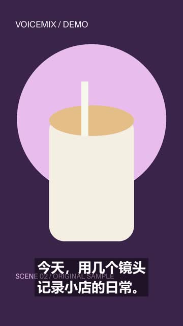

# 示例材料

`store-scripts.txt` 为十条虚构门店文案，可练习批量粘贴，不包含真实门店、价格、优惠或客户成绩。

生成程序化演示素材：

```sh
python examples/make_demo_assets.py
```

脚本使用 Pillow 生成带 DEMO 标识的图片，存入 `examples/generated/assets`，并生成一个 API 请求示例。素材为程序化插画，不是真实商品照片。

选择该素材目录，粘贴示例文案，允许复用，先设置每条生成 1 个检查。正式业务换成自己的真实素材与准确文案。

生成目录不加入 Git；公开演示应明确标注，不能作为真实客户效果证明。

## 实际生成的演示成片

使用两条示例文案及本脚本生成的自有插画，已完成配音、字幕和混剪：

- [示例一：记录小店日常](https://github.com/kkdopeboi-alt/voice-mix-studio/releases/download/v1.4.0/demo-shop-01.mp4)
- [示例二：饮品制作的细节](https://github.com/kkdopeboi-alt/voice-mix-studio/releases/download/v1.4.0/demo-shop-02.mp4)



这些是软件流程演示，不是真实拍摄、真实门店或投放效果。正式项目应使用自己的商品和门店素材。
